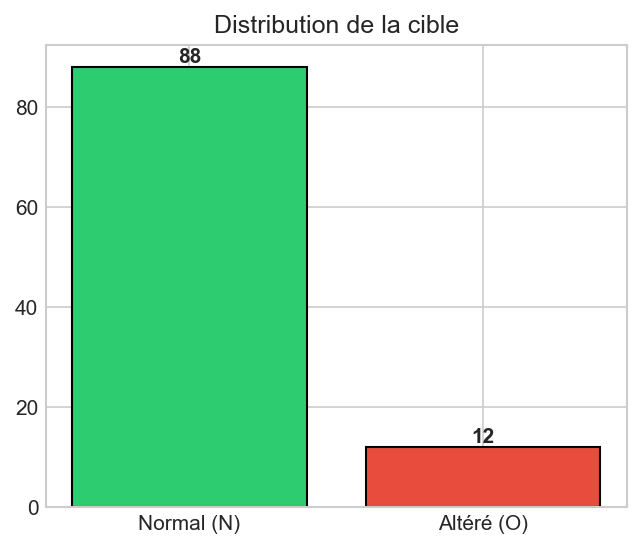
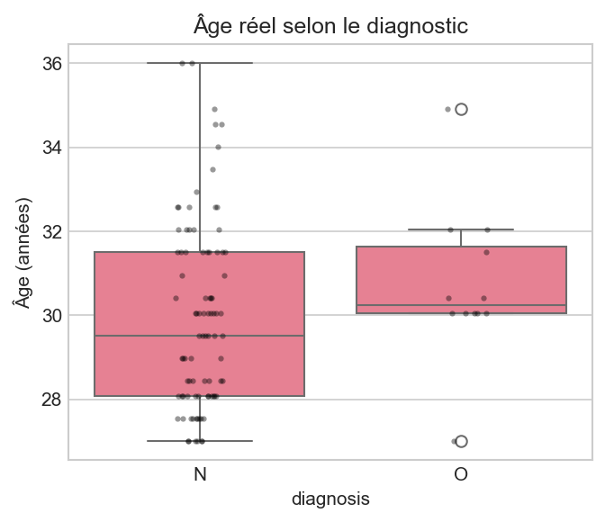
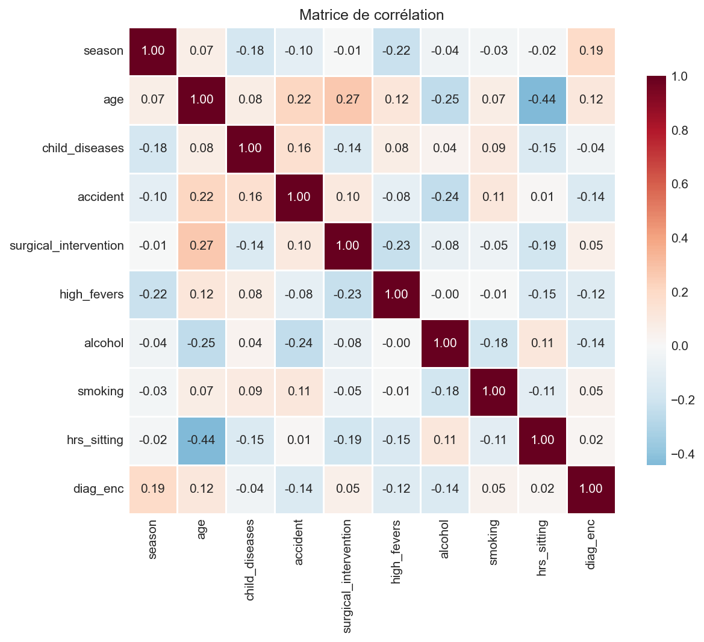
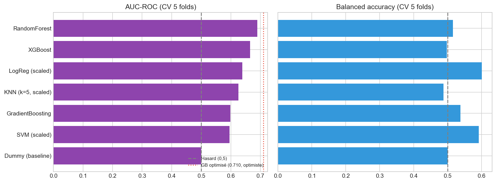
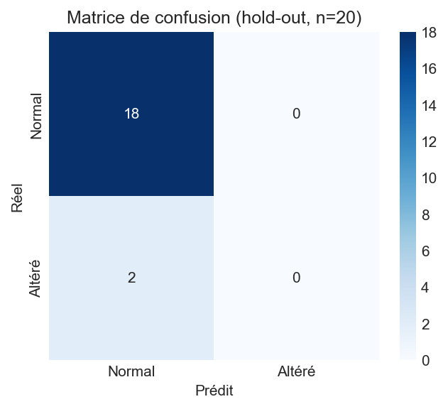
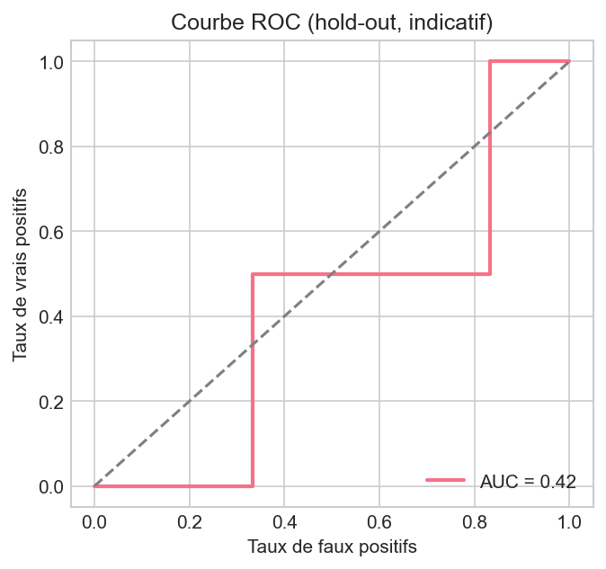
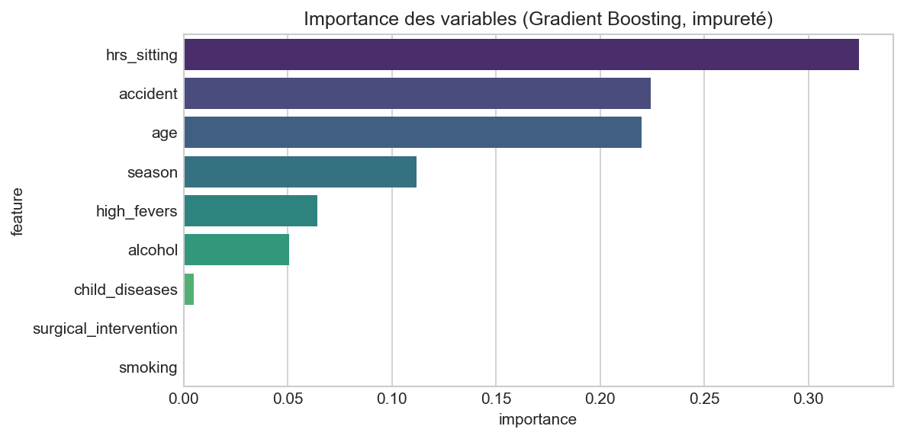
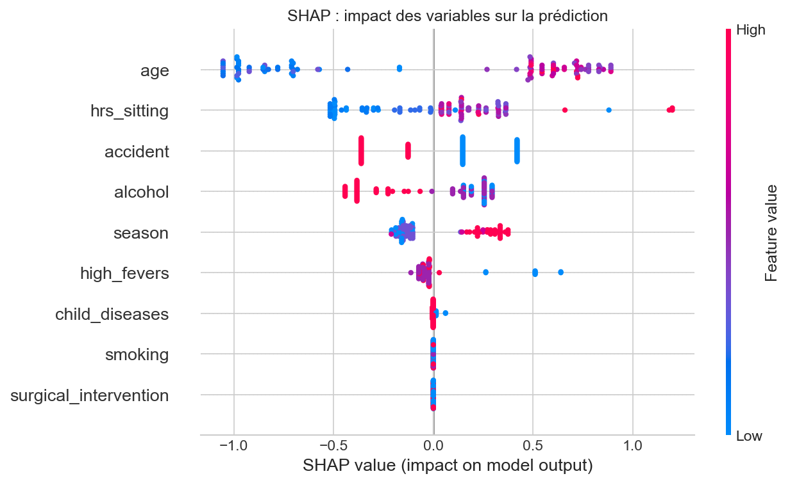

<h1 align="center">🧬 Projet de Data Science Complet :<br>Prédiction de la Fertilité Masculine 🧬</h1>

<p align="center">
  Pré-dépistage exploratoire de la fertilité masculine altérée à partir de données non invasives
</p>

<p align="center">
  
  
  
  
  
  
</p>

| | |
| :- | :- |
| 📊 **Source** | [UCI ML Repository, Fertility Dataset](https://archive.ics.uci.edu/dataset/244/fertility) |
| 👨‍🔬 **Auteurs du jeu de données** | David Gil et Jose Girela |
| 📅 **Année** | 2012 (don au dépôt UCI en janvier 2013) |
| 📜 **Licence des données** | CC BY 4.0 |
| 🔗 **DOI** | [10.24432/C5Z01Z](https://doi.org/10.24432/C5Z01Z) |

## 🎯 Objectif et problématique

L'infertilité touche environ 15 % des couples dans le monde, soit 48,5 millions de couples [2]. L'OMS estime qu'environ 17,5 % des adultes, soit 1 personne sur 6, y sont confrontés au cours de leur vie [1]. Le facteur masculin est seul responsable de 20 à 30 % des cas et intervient dans environ 50 % des cas au total [2].

Le diagnostic repose sur des examens biologiques, notamment l'analyse du sperme. Ils sont coûteux et mal vécus par certains patients. L'idée de ce projet est d'identifier en amont, à partir de données accessibles (âge, mode de vie, antécédents), les hommes à risque de fertilité altérée. Un tel outil orienterait vers un spermogramme uniquement en cas de risque identifié.

**Question centrale :** peut-on prédire de façon fiable une fertilité masculine altérée à partir de variables socio-démographiques, environnementales et de mode de vie, sans examen biologique ?

**Réponse de ce projet :** non, pas avec ces données. Sur 100 volontaires dont 12 seulement ont un diagnostic altéré, aucun modèle ne dépasse la baseline en exactitude, et le meilleur score de validation croisée (AUC 0,71) est une estimation optimiste que le hold-out ne confirme pas (AUC 0,42). Ce dépôt documente une démarche rigoureuse et ses limites, pas un outil clinique.

## 📊 Dataset

100 volontaires ont fourni un échantillon de sperme analysé selon les critères OMS 2010. Le jeu de données relie le diagnostic (normal ou altéré) à des données socio-démographiques, environnementales, de santé et de mode de vie [3]. Il contient 9 variables explicatives, 1 cible binaire et 0 valeur manquante. Cible : 88 Normal (N) et 12 Altéré (O).

| Variable | Type | Valeurs encodées | Remarque |
| :- | :- | :- | :- |
| `season` | ordinale (4) | -1 hiver, -0.33 printemps, 0.33 été, 1 automne | Saison de l'analyse, cyclique mais encodée linéairement |
| `age` | quasi-continue | 0 à 1, soit 18 à 36 ans | Âge observé : 27 à 36 ans (moyenne 30,0), par pas de 0,5 an. Reconstruit à environ 0,1 an près (valeurs arrondies à 2 décimales) |
| `child_diseases` | binaire | 0 / 1 | Maladies infantiles (varicelle, rougeole, oreillons, polio). Lue ici comme 1 = oui, voir Limites |
| `accident` | binaire | 0 / 1 | Accident ou traumatisme grave. Lue ici comme 1 = oui, voir Limites |
| `surgical_intervention` | binaire | 0 / 1 | Intervention chirurgicale. Lue ici comme 1 = oui, voir Limites |
| `high_fevers` | ordinale (3) | -1 il y a moins de 3 mois, 0 il y a plus de 3 mois, 1 aucune | Fièvres élevées dans l'année écoulée |
| `alcohol` | ordinale (5) | 0.2 plusieurs fois par jour, 0.4 chaque jour, 0.6 plusieurs fois par semaine, 0.8 une fois par semaine, 1.0 presque jamais | **Échelle inversée** : 1.0 = sobre |
| `smoking` | ordinale (3) | -1 jamais, 0 occasionnel, 1 quotidien | |
| `hrs_sitting` | quasi-continue | 0 à 1, soit 0 à 16 h par jour | Heures observées : 1 à 16, valeurs entières (moyenne 6,5) |
| `diagnosis` | cible | N normal, O altéré | Déséquilibre 88 / 12 |

##  Méthodologie

1. Chargement via `ucimlrepo` et audit qualité (valeurs manquantes, types, valeurs uniques)
2. Dictionnaire sémantique et reconversion en unités réelles (années, heures)
3. Analyse exploratoire et corrélations avec la cible
4. Encodage de la cible (N = 0, O = 1), sans one-hot (variables déjà numériques)
5. Baseline `DummyClassifier` : 88 % d'exactitude sans rien apprendre
6. Comparaison de 7 modèles en validation croisée stratifiée (5 folds, graine 42), avec pondération des classes et mise à l'échelle pour LogReg, SVM et KNN
7. Optimisation par `GridSearchCV` (54 combinaisons) sur le GradientBoosting, critère AUC-ROC
8. Évaluation hold-out 80/20, importance des variables et SHAP sur le modèle final entraîné sur les 100 individus

##  Résultats clés

Validation croisée stratifiée, 5 folds, moyennes :

| Modèle | Accuracy | Bal. Acc. | Précision | Recall | F1 | AUC-ROC |
| :- | :-: | :-: | :-: | :-: | :-: | :-: |
| RandomForest | 0.86 | 0.516 | 0.200 | 0.067 | 0.100 | 0.690 |
| XGBoost | 0.78 | 0.498 | 0.067 | 0.133 | 0.089 | 0.665 |
| LogReg (scalée) | 0.68 | 0.601 | 0.210 | 0.500 | 0.291 | 0.639 |
| KNN (k=5, scalé) | 0.86 | 0.488 | 0.000 | 0.000 | 0.000 | 0.626 |
| GradientBoosting | 0.85 | 0.538 | 0.133 | 0.133 | 0.133 | 0.599 |
| SVM (scalé) | 0.82 | 0.592 | 0.233 | 0.300 | 0.259 | 0.596 |
| Dummy (baseline) | 0.88 | 0.500 | 0.000 | 0.000 | 0.000 | 0.500 |

- **Exactitude :** aucun modèle ne dépasse la baseline (0,88). Sur une cible déséquilibrée, cette métrique est trompeuse.
- **GradientBoosting optimisé :** `learning_rate` 0,01, `max_depth` 2, `n_estimators` 200, `subsample` 1,0, pour une AUC CV de **0,710**. Cette valeur est le meilleur score de 54 combinaisons évaluées sur les mêmes folds et les mêmes données, donc optimiste [6]. Avec 12 positifs, l'erreur standard d'une AUC de 0,71 est d'environ 0,09 [5].
- **Hold-out (20 individus dont 2 positifs) :** exactitude 0,900, balanced accuracy 0,500, recall 0, AUC 0,417. Le modèle prédit « Normal » pour les 20 individus. Résultat non concluant, mais il ne confirme pas la validation croisée.
- **Importance des variables (impureté, modèle final) :** `hrs_sitting` ≈ 0,32, `accident` ≈ 0,22, `age` ≈ 0,22, `season` ≈ 0,11, `high_fevers` ≈ 0,06, `alcohol` ≈ 0,05, les trois autres variables ≈ 0.

## Visualisations et lecture


*Figure 1. Répartition de la cible (88 Normal, 12 Altéré).*

Le déséquilibre est d'environ 7 contre 1. Prédire « Normal » pour tout le monde donne 88 % d'exactitude, d'où le recours à l'AUC, à la balanced accuracy et au recall. Avec 12 positifs, toute estimation est fragile.


*Figure 2. Âge réel (27 à 36 ans) selon le diagnostic.*

Les cas altérés se concentrent entre 30 et 32 ans (médiane ≈ 30,2 ans contre ≈ 29,5 ans pour les normaux), avec deux valeurs isolées à 27 et près de 35 ans. Les distributions se recouvrent largement. La relation n'est pas monotone, ce qui explique une corrélation linéaire faible (0,115). La population étudiée ne couvre que 27 à 36 ans.


*Figure 3. Corrélations de Pearson, variables et cible encodée.*

Les corrélations avec la cible restent toutes inférieures à 0,20 en valeur absolue (`season` 0,19, `alcohol` -0,14, `accident` -0,14, `age` 0,12, `high_fevers` -0,12), sous le seuil de significativité à 5 % pour n = 100 (|r| ≈ 0,197). Les liaisons entre variables sont plus nettes : `age` et `hrs_sitting` (-0,44), `age` et `surgical_intervention` (0,27), `age` et `alcohol` (-0,25). Ces variables partagent de l'information, ce qui brouille la lecture des importances.


*Figure 4. AUC-ROC et balanced accuracy en validation croisée stratifiée.*

Tous les modèles se situent entre 0,60 et 0,69 d'AUC, au-dessus du hasard (0,5) mais avec des écarts du même ordre que l'incertitude statistique. Le RandomForest non optimisé (0,690) est proche du GradientBoosting optimisé (0,710, ligne pointillée), ce qui relativise le gain du réglage. La balanced accuracy ne dépasse 0,6 que pour la régression logistique et le SVM, au prix de nombreux faux positifs.


*Figure 5. Matrice de confusion du hold-out (n = 20).*

18 vrais négatifs, 2 faux négatifs, aucun vrai positif et aucun faux positif : le modèle ne prédit jamais « Altéré » au seuil de 0,5. L'exactitude de 90 % vient uniquement de la classe majoritaire.


*Figure 6. Courbe ROC du hold-out (indicatif, 2 positifs).*

La courbe passe sous la diagonale (AUC 0,42). Avec 2 positifs et 18 négatifs, il n'y a que 36 paires, et chaque paire déplace l'AUC de 0,028. Cette courbe en escalier traduit l'effectif minuscule et ne permet aucune conclusion de performance.


*Figure 7. Importance des variables du Gradient Boosting (impureté, modèle final).*

`hrs_sitting` arrive en tête alors que sa corrélation avec la cible est quasi nulle (0,02). L'importance par impureté favorise les variables à nombreuses valeurs et reflète en partie du sur-ajustement [7]. `smoking` et `surgical_intervention` ont une importance nulle, ce qui ne prouve pas l'absence d'effet : la puissance statistique est trop faible.


*Figure 8. Impact des variables sur la prédiction (SHAP, en log-odds, sur les données d'entraînement).*

- **`age` :** les âges élevés poussent la prédiction vers « Altéré » et les âges faibles vers « Normal », avec une cassure nette autour de 30 ans. Elle reflète la concentration des cas entre 30 et 32 ans.
- **`hrs_sitting` :** plus d'heures assises va avec un risque plus élevé, mais l'effet est dispersé et la corrélation brute est nulle.
- **`alcohol` :** une consommation fréquente (valeurs basses) pousse vers « Altéré » et la sobriété vers « Normal ». C'est le sens attendu.
- **`high_fevers` :** les quelques individus avec une fièvre récente (valeur -1) sont poussés vers « Altéré ». Hypothèse cohérente avec l'idée qu'une fièvre perturbe la production de sperme, à tester sur un échantillon plus large.
- **`accident` :** l'effet dépend du codage. Sous la lecture 1 = oui, un accident est protecteur, ce qui est contre-intuitif. Sous la lecture littérale 0 = oui, c'est un facteur de risque.
- **`season` :** été et automne vont avec un risque plus élevé, hiver et printemps avec un risque plus faible (saison de l'analyse).

Ces explications décrivent le modèle sur ses propres données d'entraînement, pas un mécanisme biologique établi.

## 🩺 Interprétation clinique

- **Pas d'outil de dépistage en l'état.** Les corrélations sont faibles et le hold-out ne confirme pas la validation croisée.
- **Hypothèses plausibles, non confirmées :** consommation d'alcool, fièvre récente et classe d'âge ressortent dans le sens attendu, en cohérence avec l'idée des auteurs du jeu de données que l'environnement et les habitudes de vie influencent la qualité du sperme [3]. Ces associations sont exploratoires et non causales.
- **Compromis du seuil :** la régression logistique détecte la moitié des cas altérés (recall 0,50) avec une précision d'environ 0,21. Tout outil réel devra choisir un seuil selon le coût d'un faux négatif et d'un faux positif.
- **Le spermogramme reste la référence.** Ces résultats servent à formuler des hypothèses pour une étude plus large, pas à orienter un patient.

## Limites et pistes d'amélioration

- **Taille :** n = 100 dont 12 positifs, variance très élevée. Validation externe indispensable.
- **Sélection optimiste :** l'AUC de 0,710 n'est pas une performance de généralisation. Piste : validation croisée imbriquée et validation croisée répétée avec écarts-types [6].
- **Hold-out :** 20 individus dont 2 positifs, split non stratifié. Piste : évaluation stratifiée répétée.
- **Seuil de décision :** à 0,5, la classe « Altéré » n'est presque jamais prédite. Piste : calibrer le seuil sur la courbe précision-rappel.
- **Codage des variables binaires :** la documentation indique « 1) oui, 2) non » associé à (0, 1). Lue littéralement, la valeur 0 signifierait oui. Ce projet suppose 1 = oui, car 87 % de valeurs à 1 pour les maladies infantiles est plus plausible que 87 % de volontaires sans aucune de ces maladies. Les données seules ne permettent pas de trancher : aucune conclusion clinique n'est tirée sur `child_diseases`, `accident` et `surgical_intervention`.
- **Saison :** encodée linéairement alors qu'elle est cyclique. Piste : encodage sinus et cosinus.
- **Importance :** par impureté, donc biaisée [7]. Piste : importance par permutation, évaluée en validation croisée.
- **Population :** 27 à 36 ans, aucune donnée biologique. Aucune extrapolation hors de cette tranche.

## Structure du dépôt

```
male-fertility-prediction/
    README.md
    LICENSE
    requirements.txt
    .gitignore
    notebooks/
        fertility_analysis.ipynb
    src/
        __init__.py
        data_loader.py
        model.py
        predict.py
    data/
        .gitkeep
    models/
        .gitkeep
    assets/
        01_target_distribution.png ... 08_shap_summary.png
    tests/
        test_predict.py
```

##  Reproduction

```bash
git clone https://github.com/Kone320/male-fertility-prediction.git
cd male-fertility-prediction
python -m venv .venv
source .venv/bin/activate        # Windows : .venv\Scripts\activate
pip install -r requirements.txt
jupyter notebook notebooks/fertility_analysis.ipynb
python -m pytest
```

Les données sont téléchargées automatiquement par `ucimlrepo` (connexion nécessaire à la première exécution).

##  Références

1. Organisation mondiale de la santé (2023). *1 in 6 people globally affected by infertility*. [who.int](https://www.who.int/news/item/04-04-2023-1-in-6-people-globally-affected-by-infertility)
2. Agarwal A., Mulgund A., Hamada A., Chyatte M.R. (2015). A unique view on male infertility around the globe. *Reproductive Biology and Endocrinology*, 13:37. [doi:10.1186/s12958-015-0032-1](https://doi.org/10.1186/s12958-015-0032-1)
3. Gil D., Girela J.L., De Juan J., Gomez-Torres M.J., Johnsson M. (2012). Predicting seminal quality with artificial intelligence methods. *Expert Systems with Applications*, 39(16):12564-12573. [doi:10.1016/j.eswa.2012.05.028](https://doi.org/10.1016/j.eswa.2012.05.028)
4. Girela J.L., Gil D., Johnsson M., Gomez-Torres M.J., De Juan J. (2013). Semen parameters can be predicted from environmental factors and lifestyle using artificial intelligence methods. *Biology of Reproduction*, 88(4). [doi:10.1095/biolreprod.112.104653](https://doi.org/10.1095/biolreprod.112.104653)
5. Hanley J.A., McNeil B.J. (1982). The meaning and use of the area under a receiver operating characteristic (ROC) curve. *Radiology*, 143(1):29-36.
6. Varma S., Simon R. (2006). Bias in error estimation when using cross-validation for model selection. *BMC Bioinformatics*, 7:91.
7. Strobl C., Boulesteix A.-L., Zeileis A., Hothorn T. (2007). Bias in random forest variable importance measures. *BMC Bioinformatics*, 8:25.

Citation du jeu de données :

```bibtex
@misc{gil_girela_fertility_2012,
  author    = {Gil, David and Girela, Jose},
  title     = {Fertility},
  year      = {2012},
  publisher = {UCI Machine Learning Repository},
  doi       = {10.24432/C5Z01Z},
  url       = {https://archive.ics.uci.edu/dataset/244/fertility}
}
```

##  Licence et contact


Auteur du dépôt : [Kone320](https://github.com/Kone320) sur GitHub.
